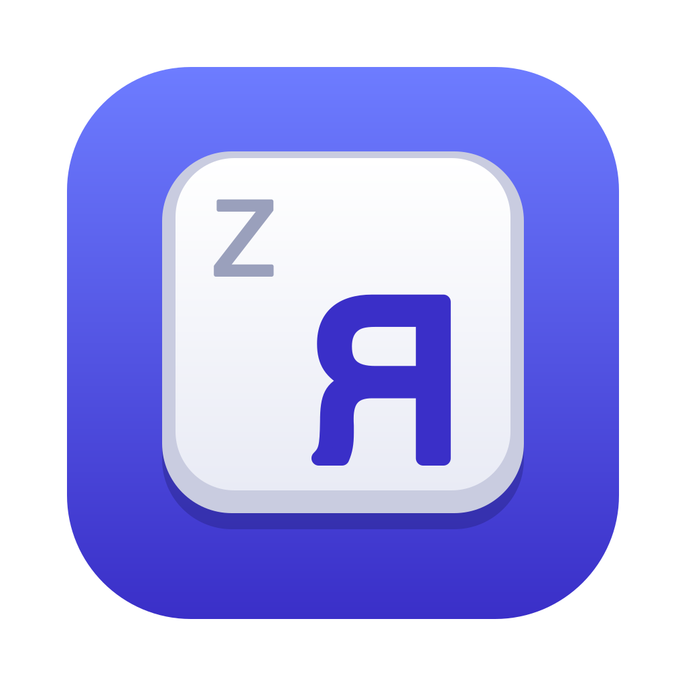
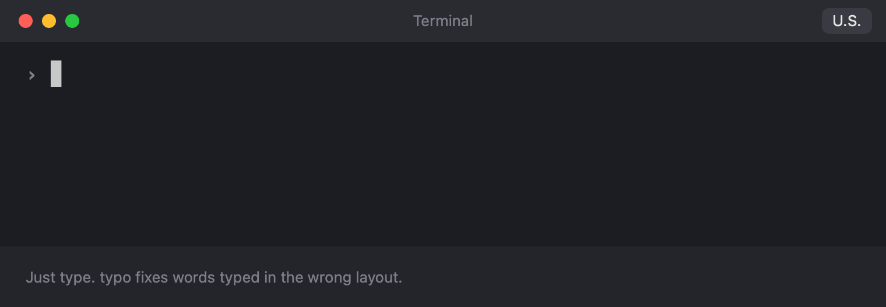

<p align="center">
  
</p>

<h1 align="center">typo</h1>

<p align="center">
  Fixes words typed in the wrong keyboard layout on macOS.<br>
  Type <code>ghbdtn</code>, press Space, get <code>привет</code>.
</p>

<p align="center">
  <a href="https://github.com/mchepurnoy/typo/releases/latest"><b>Download for macOS</b></a>
  · macOS 14+ · Apple silicon and Intel · free and open source
</p>

<p align="center">
  
</p>

typo sits in the menu bar and checks every word when you press Space. If the word only makes sense in your other layout, typo retypes it there, and after two such words in a row it switches the layout for you. Like Punto Switcher, but open source, offline and native.

- **Accurate.** On news text it has never seen, typo fixes **over 99%** of words typed in the wrong layout and touches **fewer than 1 in 10,000** words typed right. Russian, English, German and Spanish.
- **Leaves tech words alone.** `nginx` or `nodejs` in the middle of a Russian sentence comes back in Latin without flipping your layout. Links, paths, commands, `camelCase` and words with digits are never changed.
- **Private.** Only the current word is kept, in memory. Nothing you type is written to disk or sent anywhere, and password fields are skipped entirely.
- **Native and light.** A small Swift app: no account, no Electron, no network except optional update checks. It decides in under a millisecond per word.

---

## Install

1. Download `Typo-<version>.zip` from the [latest release](https://github.com/mchepurnoy/typo/releases/latest), unzip it and drag **Typo.app** to Applications. It is signed and notarized by Apple.
2. Open it. The **Set Up Typo** window asks for two permissions, and its buttons open the right pages in System Settings:
   - **Input Monitoring**, to see what you type;
   - **Accessibility**, to replace the word.

   typo starts working as soon as both are granted, without a relaunch.
3. Have both layouts enabled in **System Settings → Keyboard → Input Sources**, e.g. U.S. or ABC and Russian – PC. Any layout of a supported language takes part.

> [!TIP]
> In the same Input Sources settings, turn off **Automatically switch to a document's input source**. Otherwise macOS undoes the layout switches typo makes.

typo updates itself from GitHub Releases. On the second launch it asks whether to check once a day.

## Use

Just type. A word is fixed when you press Space, Return or Tab.

| To | Do |
| --- | --- |
| Undo a fix | Press **Backspace** right after it. The word comes back and typo never fixes it again. |
| Convert a word typo missed | **Double-tap Shift.** The last word switches layout, and typo learns it. |
| Pause typo, e.g. for a password | Press and release **⌃⌘** together. Again to resume. |
| Never touch some app | **Settings → Excluded Apps.** |

typo also fixes typos in the right layout (`превет` → `привет`, `teh` → `the`) and restores a certain ё, umlaut or accent (`еще` → `ещё`, `konnen` → `können`). **Settings → Statistics** shows how many words it fixed and roughly how much time that saved. Every one of these can be turned off in Settings.

## Privacy

typo sees every key you press, so here is exactly what it keeps:

- **What you type:** only the current word, in memory, never on disk, in logs or on the network ([ADR 0003](docs/adr/0003-never-store-typed-text.md)).
- **On disk:** your settings, exceptions, learned words and per-day counts of fixes for 8 weeks, without the words ([ADR 0004](docs/adr/0004-daily-correction-counts.md)).
- **Network:** checking GitHub for updates and downloading them, if you allow it. Nothing about you is sent ([ADR 0005](docs/adr/0005-updates-from-github-releases.md)).

**Password fields** are left alone: no fixes, no learning, nothing remembered. Most of them turn on macOS secure input, which hides every key from typo; for the rest, typo asks Accessibility whether the focused field is a password field. The one case it cannot see is a password prompt in a terminal (`sudo`, `ssh`), which is plain text to macOS. If you type passwords there, turn on **Terminal → Secure Keyboard Entry** (iTerm2: **iTerm2 → Secure Keyboard Entry**) or add the terminal to **Settings → Excluded Apps**.

## Uninstall

Quit typo from its menu and delete Typo.app. To remove its settings and permissions too:

```sh
defaults delete app.typo.Typo
tccutil reset Accessibility app.typo.Typo
tccutil reset ListenEvent app.typo.Typo
```

## Build from source

```sh
scripts/build-app.sh && open build/Typo.app
```

Needs Xcode 16 or its command-line tools. Testing, releases and the language models are covered in [docs/development.md](docs/development.md).

## License

typo is free software under the [GNU General Public License v3.0 only](LICENSE) ([ADR 0002](docs/adr/0002-gplv3-license.md)). Its language models are built from the [Leipzig Corpora Collection](https://wortschatz.uni-leipzig.de/en/download) (CC BY); see [LanguageModels/SOURCES.md](LanguageModels/SOURCES.md).
